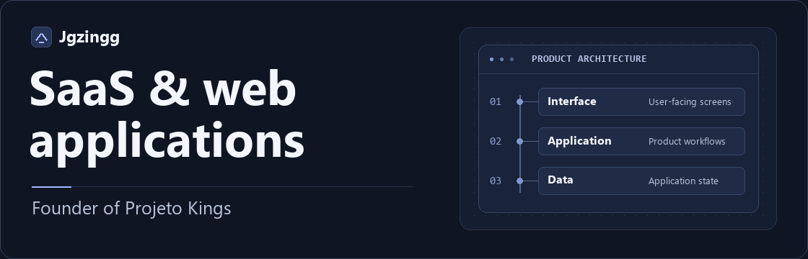

<picture>
  <source media="(prefers-reduced-motion: no-preference)" srcset="./assets/jgzingg-saas.gif">
  
</picture>

# SaaS & web applications

I'm **Jgzingg**, a developer from Brazil and founder of **Projeto Kings**. I work with TypeScript on the web and Python for automation.

[Visit Projeto Kings](https://projeto-kings-site.vercel.app/) · [Discuss a project](#contact)

## What I can help you build

- **SaaS MVPs** · Build the first version around the workflow your users need most.
- **Dashboards and internal tools** · Give your team a place to review data and manage day-to-day operations.
- **Automation and integrations** · Connect the tools you already use and reduce manual work.

## Selected open-source work

- **OpenSlop** · Expanded a video editor's timeline from 7 to 18 zoom levels, up to 64×, and added tests for zoom steps and limits. [Merged pull request](https://github.com/openslop/openslop/pull/1175)
- **Messline** · Fixed the meal booking app's mobile menu so its table scrolls inside the page on narrow screens. [Merged pull request](https://github.com/sanjana2505006/Messline/pull/30)

## Contact

Working on a web product? Tell me who it’s for and what the first version needs to do. Find me on Discord at **`@jgzingg`** or visit [Projeto Kings](https://projeto-kings-site.vercel.app/).
