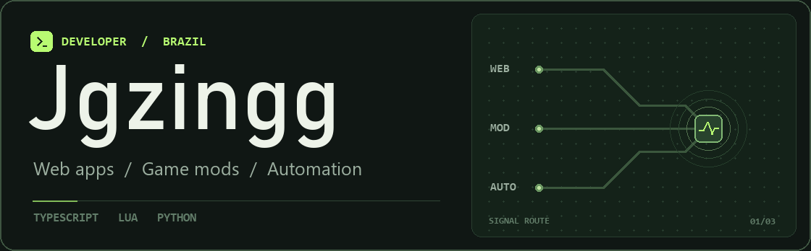

<picture>
  <source media="(prefers-reduced-motion: no-preference)" srcset="./assets/jgzingg-signal.gif">
  
</picture>

  <a href="https://projeto-kings-site.vercel.app/"><strong>Projeto Kings</strong></a>
  &nbsp;·&nbsp;
  <a href="#open-source">Open source</a>
  &nbsp;·&nbsp;
  <a href="#projects">Projects</a>
  &nbsp;·&nbsp;
  <a href="#contact">Contact</a>

## What I'm building

I founded **Projeto Kings** to build websites and custom web tools. I also work on game mods and automation with TypeScript, Lua, and Python.

## Open source

- **OpenSlop** · Expanded timeline zoom from 7 to 18 levels, up to 64×, and added tests for zoom steps and limits. [Merged PR #1175](https://github.com/openslop/openslop/pull/1175)
- **Messline** · Fixed the mobile menu layout so the table scrolls within its container on narrow screens. [Merged PR #30](https://github.com/sanjana2505006/Messline/pull/30)

## Projects

- **[DriftMod Standalone](https://github.com/Jgzingg/DriftMod--Standalone-beta.0.9.8)** · FiveM prototype in Lua with an in-game drift menu, handling presets, and live traction and steering adjustments.
- **[Ultimate Windows Optimizer](https://github.com/Jgzingg/ultimate-windows-optimizer)** · My first public project, a Python desktop app for applying selected Windows settings.
- **[Bedrock WorldEdit](https://github.com/Jgzingg/tata-d)** · Archived Minecraft Bedrock add-on that processes large region edits in batches.

## Contact

I'm open to commissions and collaborations. Find me on Discord at **`@jgzingg`** or browse my [CurseForge projects](https://www.curseforge.com/members/jgzingg/projects).

  
Contribution activity

   
  <picture>
    <source media="(prefers-color-scheme: dark)" srcset="https://raw.githubusercontent.com/Jgzingg/Jgzingg/output/github-contribution-grid-snake-dark.svg">
    
  </picture>

