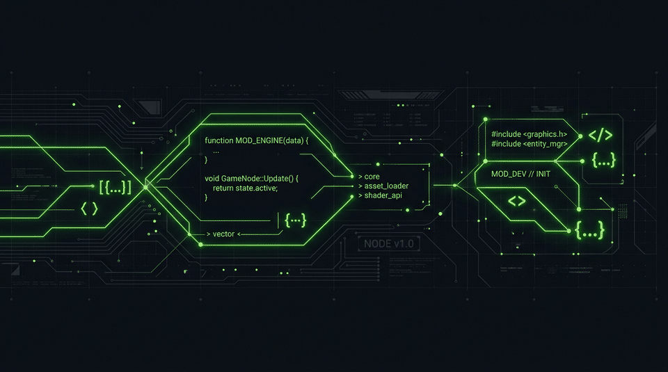

  

 

  <h1>Jgzingg</h1>
  
  

  
<strong>Developer from Brazil working across web development, game modding and custom tools.</strong>

  

    
    
      &nbsp;<strong>SYSTEM STATUS:</strong> Building <strong>Projeto Kings</strong> &nbsp;|&nbsp; Open for custom tools &amp; commissions
    
  

 

  

 

### ⚡ Venture in Progress

<table>
  <tr>
    <td width="100%">
      <h4><a href="https://projeto-kings-site.vercel.app/">Projeto Kings</a> — CEO &amp; Founder</h4>
      
A web development business currently under development, architecting high-performance digital experiences and custom web solutions.

      
🌐 <strong>Website:</strong> <a href="https://projeto-kings-site.vercel.app/">projeto-kings-site.vercel.app</a>

    </td>
  </tr>
</table>

 

  

 

### 🛠️ Development Focus & Ecosystem

- **FiveM Development:** Custom gameplay mechanics, client/server standalone scripts, and performant Lua systems.
- **Project Zomboid Modding:** Custom scripts, game mechanics extensions, and item balancing tools.
- **Minecraft Bedrock Add-ons:** Custom behaviors, automation add-ons, and technical tooling.
- **Web Development & Automation:** Full-stack web applications, TypeScript/JavaScript tooling, and Python automation utilities.

 

  

 

  

 

### 📂 Public Projects & Technical Experiments

| Project | Focus | Status |
| :--- | :--- | :--- |
| **[DriftMod-Standalone](https://github.com/Jgzingg/DriftMod--Standalone-beta.0.9.8)** | FiveM Standalone Handling & Drift Menu (Lua) | `Prototype / v0.9 Reference` *(Superseded by private build)* |
| **[Bedrock WorldEdit](https://github.com/Jgzingg/tata-d)** | Minecraft Bedrock Add-on & Batch Algorithms (JS) | `Archived / Discontinued` *(Public technical reference)* |
| **[Ultimate Windows Optimizer](https://github.com/Jgzingg/ultimate-windows-optimizer)** | Windows Performance & Optimization Script (Python) | `Public Utility` |

 

  

 

### 📊 GitHub Activity & Statistics

  
  

  

 

  <picture>
    <source media="(prefers-color-scheme: dark)" srcset="https://raw.githubusercontent.com/Jgzingg/Jgzingg/output/github-contribution-grid-snake-dark.svg">
    <source media="(prefers-color-scheme: light)" srcset="https://raw.githubusercontent.com/Jgzingg/Jgzingg/output/github-contribution-grid-snake.svg">
    
  </picture>

 

  

 

### 🔗 Connect & Links

- **Business:** [Projeto Kings](https://projeto-kings-site.vercel.app/)
- **CurseForge:** [curseforge.com/members/jgzingg/projects](https://www.curseforge.com/members/jgzingg/projects)
- **Discord:** `@jgzingg`
